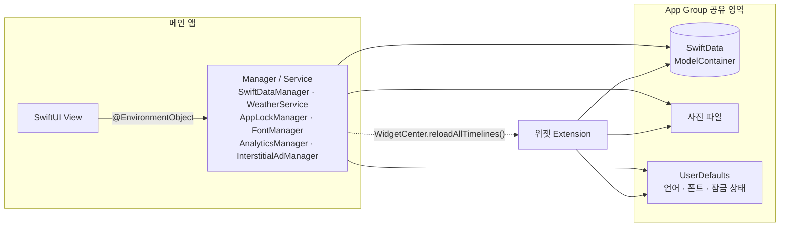
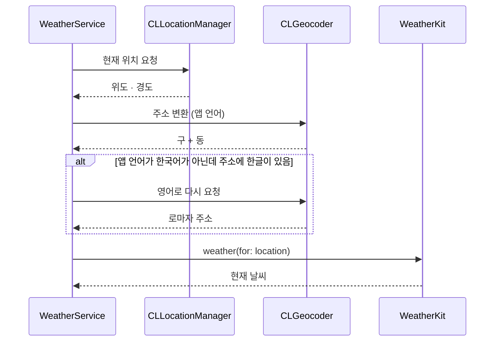
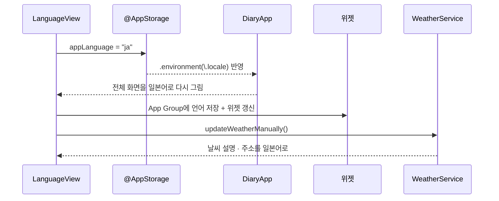

<p align="center">
  
</p>

<h1 align="center">굿디 — 날씨와 함께 쓰는 일기</h1>

<p align="center">
  오늘의 날씨와 사진 한 장으로 하루를 남기는 개인 다이어리 앱<br/>
  홈 화면 위젯 · 앱 잠금(PIN · Face ID) · 한국어 / English / 日本語
</p>

<p align="center">
  <a href="https://apps.apple.com/kr/app/id6745007157">
    
  </a>
</p>

<p align="center">
  
  
  
  
  
  
</p>

---


## 스크린샷

| 홈 (표지 · 날씨) | 기록 | 일기 상세 |
|:---:|:---:|:---:|
|  |  |  |

| 캘린더 | 앱 잠금 (PIN · Face ID) | 위젯 (Large · Medium) |
|:---:|:---:|:---:|
|  |  |  |

---

## 소개

| | |
|---|---|
| 서비스 | 날씨 기반 일기장 · 홈 화면 위젯 · 앱 잠금 · 다국어를 지원하는 개인 다이어리 |
| 기간 | 2025.02 ~ 현재 (App Store 출시 후 운영 중) |
| 구성 | iOS 개발 1인 |
| 현재 버전 | 2.2.0 |

---

## 주요 기능

### 🔒 앱 잠금 (PIN + Face ID / Touch ID)
- 4자리 PIN과 Face ID · Touch ID로 앱 전체를 잠급니다. PIN은 원문이 아니라 **PBKDF2로 변환한 값**을 Keychain에 저장합니다.
- 여러 번 틀리면 입력을 일정 시간 막습니다(**5회 30초, 10회 5분**). 앱을 껐다 켜도 유지됩니다.
- 잠금 중에는 **앱 스위처 미리보기**와 **홈 화면 위젯의 일기 내용**도 가립니다.
- 생체 인증은 기기 암호로 대신 열리지 않도록 생체 전용 정책을 쓰고, 취소 · 실패는 모두 PIN 입력으로 이어집니다.

### 🌤️ 현재 위치 날씨
- WeatherKit(async/await) + CoreLocation으로 현재 날씨 · 기온 · 지역명을 표시하고, Combine 타이머로 10분마다 갱신합니다.
- 오늘 일기를 쓰면 그때의 날씨가 함께 저장되어 기록 · 상세 · 캘린더에 손그림 날씨 아이콘으로 표시됩니다.

### 📅 SwiftUI 커스텀 캘린더
- FSCalendar를 걷어내고 `LazyVGrid`로 직접 구현했습니다. 작성한 날은 날씨별 파스텔 원, 오늘은 테두리, 미래 날짜는 비활성입니다.
- 최근 사진이 있는 일기 4개를 **Memories** 썸네일로 보여 줍니다.

### 🧩 SwiftData + App Group 위젯
- App Group으로 공유하는 ModelContainer를 통해 메인 앱과 위젯 3종(Small · Medium · Large)이 같은 데이터를 봅니다.
- 오늘 사진(ImageIO로 다운샘플링), 총 기록 수, 이번 달 작성일을 표시하고, 앱에서 고른 손글씨 폰트를 위젯에도 적용합니다.

### 🌏 다국어 (한국어 · English · 日本語)
- String Catalog 기반 3개 국어. 앱 안에서 언어를 바꾸면 재시작 없이 바로 적용됩니다.
- `appLocale` 헬퍼로 DateFormatter · CLGeocoder · 캘린더 · 로컬 알림 문구까지 앱 언어를 따르게 했습니다.

### 🖼️ 사진
- PhotosPicker로 고른 사진은 App Group 컨테이너에 파일로 저장하고, SwiftData에는 **파일명만** 저장합니다.
- `UIScrollView`를 감싼 핀치 줌 전체 화면 뷰어를 제공합니다.

### 🎨 디자인 시스템 · 손글씨 폰트
- 색상 · 간격 · 모서리 · 그림자 토큰과 `.appCard()` · `.polaroid()` · 종이 질감 배경으로 모든 화면의 스타일을 통일했습니다.
- 손글씨 폰트 4종. 앱은 `ObservableObject` + `ViewModifier`로 전체 적용하고, 위젯은 App Group으로 설정을 공유합니다.

### 📈 광고 · 운영 지표
- AdMob 배너, 네이티브(기록 3개마다), 전면(저장 3회마다, 최소 2분 간격). **비개인화(NPA) 광고만 요청**해 사용자 추적 없이 운영합니다.
- Firebase Analytics 이벤트를 enum으로 정의해 문자열 오타로 인한 집계 누락을 막았고, Crashlytics로 크래시를 수집합니다.

---

## 기술 스택

| 분류 | 사용 기술 |
|---|---|
| UI | SwiftUI, Combine |
| 데이터 | SwiftData, App Group (공유 컨테이너 · UserDefaults) |
| 시스템 | WidgetKit, WeatherKit, CoreLocation, UserNotifications, PhotosUI, ImageIO |
| 보안 | LocalAuthentication, Keychain(Security), CommonCrypto(PBKDF2) |
| 다국어 | String Catalog |
| 라이브러리 | Firebase (Analytics · Crashlytics · Messaging), Google Mobile Ads |

---

## 구조



- **View + ObservableObject 매니저.** View는 `@State`로 화면 상태를, 앱 전체가 공유하는 상태는 `ObservableObject` 매니저의 `@Published`로 받습니다. 날씨 · 폰트 · 잠금 · 광고 · 분석처럼 화면과 상관없는 일은 각 Service로 분리했습니다.
- **App Group으로 앱과 위젯이 같은 데이터를 봅니다.** 위젯은 별도 프로세스라 앱의 저장 공간을 직접 볼 수 없습니다. 그래서 데이터베이스 · 사진 · 설정을 App Group 영역에 두고, 앱에서 일기가 바뀌면 위젯 갱신을 요청합니다.

---

## 트러블슈팅

### 1. 위젯에 손글씨 폰트가 적용되지 않음

**문제**
위젯은 메인 앱과 별도 타깃 · 별도 프로세스라, 앱에 등록한 커스텀 폰트와 사용자가 고른 폰트 설정을 위젯에서 쓸 수 없었습니다.

**해결**
폰트 파일 4종을 위젯 타깃에도 추가하고 위젯 Info.plist의 `UIAppFonts`에 등록했습니다. 사용자가 고른 폰트 이름은 App Group UserDefaults로 공유하고, 바뀌면 위젯을 갱신합니다.

```swift
// 앱: 폰트를 바꾸면 App Group에 저장하고 위젯 갱신 (FontManager.swift)
func changeFont(to fontName: String) {
    currentFont = fontName
    let sharedDefaults = UserDefaults(suiteName: SharedModelContainer.appGroupIdentifier)
    sharedDefaults?.set(fontName, forKey: "selectedFont")
    WidgetCenter.shared.reloadAllTimelines()
}

// 위젯: 같은 App Group에서 폰트 이름을 읽음 (DiaryWidget.swift)
let sharedDefaults = UserDefaults(suiteName: SharedModelContainer.appGroupIdentifier)
let fontName = sharedDefaults?.string(forKey: "selectedFont") ?? "Cafe24DongdongOTF"
```

### 2. 앱 업데이트 후 저장한 사진이 사라짐

**문제**
이미지의 절대 경로를 SwiftData에 저장해서, 앱 업데이트로 샌드박스 경로(UUID)가 바뀌면 사진을 불러오지 못했습니다. 이후 위젯을 추가하면서, 별도 프로세스인 위젯은 앱의 Documents 폴더에 접근할 수 없는 문제도 생겼습니다.

**해결**
SwiftData에는 파일명만 저장하고 경로는 실행할 때마다 조합하도록 바꿨습니다. 위젯 지원을 위해 저장 위치를 App Group 컨테이너로 옮기면서, **기존 사진은 원본을 지우지 않고 한 번만 복사**하고 읽을 때는 Documents로 폴백해 기존 사용자의 사진이 사라지지 않게 했습니다.

```swift
// 읽기: App Group 먼저, 없으면 예전 위치(Documents) (FileManagerSet.swift)
static func loadImageFromFileManager(fileName: String) -> UIImage? {
    let candidates = [
        appGroupDirectory?.appendingPathComponent(fileName),
        documentsDirectory.appendingPathComponent(fileName)
    ].compactMap { $0 }

    for url in candidates {
        if let data = try? Data(contentsOf: url), let image = UIImage(data: data) {
            return image
        }
    }
    return nil
}

// 이전: 최초 1회, 원본은 그대로 두고 "복사"만
for src in files where src.pathExtension.lowercased() == "jpg" {
    let dest = appGroupDir.appendingPathComponent(src.lastPathComponent)
    if !fm.fileExists(atPath: dest.path) {
        try? fm.copyItem(at: src, to: dest)
    }
}
```

### 3. 앱 언어를 바꿔도 기록 목록의 날짜가 바뀌지 않음

**문제**
셀의 날짜는 이미 만들어 둔 문자열이라 언어 설정과 연결이 없어서, 언어를 바꿔도 List가 셀을 다시 그리지 않았습니다.

**해결**
`DiaryCell`이 `@AppStorage("appLanguage")`를 직접 관찰하게 해서, 언어가 바뀌면 셀이 다시 그려지며 새 언어로 날짜를 만들도록 했습니다.

```swift
struct DiaryCell: View {
    // 날짜는 평범한 String이라 언어를 바꿔도 갱신되지 않는다.
    // appLanguage를 관찰하면 언어 변경 시 셀 body가 다시 실행되어 날짜가 새 언어로 만들어진다.
    @AppStorage("appLanguage") private var appLanguage: String = resolvedSystemLanguage()
    // ...
}
```

### 4. 홈 화면 위젯이 흰 빈칸으로만 표시됨

**문제**
위젯을 홈 화면에 추가해도 내용 없이 흰 칸만 보였습니다. 빌드 에러도, 앱 크래시도 없었습니다. 위젯 Extension의 시스템 로그를 확인하니 WidgetKit이 위젯 화면을 저장하는 단계에서 실패하고 있었습니다.

```text
Widget archival failed due to image being too large [1] - (1536, 1024),
totalArea: 1572864 > max[1069415.6]
```

WidgetKit은 위젯에 들어가는 이미지 한 장의 크기에 한도가 있고, 이를 넘으면 위젯 전체를 그리지 않습니다. 사진은 ImageIO로 줄이고 있었지만, 기록 일수 배지의 새싹 아이콘과 밤 날씨 아이콘은 원본(1536×1024)을 그대로 위젯 에셋에 넣은 것이 원인이었습니다. 새싹 배지는 일기가 하나라도 있으면 항상 표시되어 모든 위젯이 영향을 받았습니다.

**해결**
위젯 타깃의 에셋 3개(sesac · clear_night · cloudy_night)만 실제 표시 크기에 맞게 384×256으로 줄였습니다(앱 타깃 원본은 유지). 위젯에 넣는 이미지는 표시 크기의 3배(@3x) 이하로 준비한다는 기준을 세웠습니다.

---

## 기술 메모

<details>
<summary><b>① 일본어 설정에서 한국 주소가 번역되지 않는 문제 — 한글 감지 후 영어로 다시 요청</b></summary>

<br/>

앱 언어를 일본어로 두고 한국에 있으면, CLGeocoder에 일본어를 요청해도 한국 주소가 한글로 그대로 돌아왔습니다(지도 데이터에 일본어 번역이 없음). 그래서 결과에 한글이 있으면 영어로 한 번 더 요청해 로마자 주소를 보여 줍니다.

```swift
// WeatherService+Location.swift
if currentLangCode != "ko" && address.containsKorean {
    let enGeocoder = CLGeocoder()
    let enPlacemarks = try await enGeocoder.reverseGeocodeLocation(location, preferredLocale: Locale(identifier: "en"))
    if let enPlacemark = enPlacemarks.first,
       let enGu = enPlacemark.locality,
       let enDong = enPlacemark.subLocality {
        return "\(enGu) \(enDong)"
    }
}
```



</details>

<details>
<summary><b>② 앱을 다시 켜지 않고 언어 바꾸기 — @AppStorage + .environment(\.locale)</b></summary>

<br/>

선택한 언어를 `@AppStorage("appLanguage")`에 저장하고, 앱 최상단에 `.environment(\.locale, ...)`을 걸어 값이 바뀌면 화면 전체가 새 언어로 다시 그려지게 했습니다. DateFormatter · CLGeocoder처럼 SwiftUI 밖의 API에는 `appLocale`로 언어를 직접 넘깁니다. 위젯에는 App Group으로 언어를 공유하고, 날씨 · 주소도 새 언어로 다시 받아 옵니다.

```swift
// DiaryApp.swift
.environment(\.locale, Locale(identifier: appLanguage))

// SwiftUI 밖의 API용
var appLocale: Locale {
    let code = UserDefaults.standard.string(forKey: "appLanguage") ?? resolvedSystemLanguage()
    return Locale(identifier: code)
}
```



</details>

<details>
<summary><b>③ 날씨는 10분마다, 앱이 켜져 있을 때만 갱신</b></summary>

<br/>

Combine 타이머를 메인 RunLoop에 두면 앱이 백그라운드로 가면 함께 멈춥니다. 그래서 화면을 보고 있을 때만 10분마다 날씨를 갱신하고, 불필요한 WeatherKit 호출과 배터리 사용을 줄였습니다.

```swift
// WeatherService.swift
timer = Timer.publish(every: 600, on: .main, in: .common)
    .autoconnect()
    .sink { [weak self] _ in
        self?.updateWeatherManually()
    }
```

</details>

<details>
<summary><b>④ 위젯을 누르면 바로 일기 쓰기 — 잠겨 있으면 해제 후 이동</b></summary>

<br/>

위젯은 `diary://compose` 링크로 앱을 엽니다. 앱 잠금이 켜져 있으면 링크를 바로 처리하지 않고 보관해 두었다가, 잠금이 풀리는 순간 일기 쓰기 화면으로 이동합니다. 잠금을 건너뛰고 화면이 열리는 일을 막기 위해서입니다.

```swift
// DiaryWidget.swift
Link(destination: URL(string: "diary://compose")!) { /* ... */ }

// DiaryApp.swift
private func handleDeepLink(_ url: URL) {
    // 잠겨 있으면 실행하지 않고 보관. 해제되는 순간 다시 이 함수가 불린다.
    guard lockManager.state == .unlocked else {
        pendingDeepLink = url
        return
    }
    if url.scheme == "diary", url.host == "compose" {
        // 일기 작성 화면으로 이동
    }
}
```

</details>

---

## 업데이트 기록 (git 기준)

| 버전 | 시기 | 내용 |
|---|---|---|
| 2.2.0 | 2026.09 | 앱 잠금 (PIN · Face ID / Touch ID), 앱 스위처 · 위젯 가림 |
| 2.1.0 | 2026.08 | 위젯 2.0 디자인, 위젯 손글씨 폰트, 위젯 오늘 사진 (사진 App Group 이전) |
| 2.0.0 | 2026.08 | 디자인 전면 개편 (4탭 · 일기책 표지 홈 · 커스텀 캘린더 · 디자인 시스템), AdMob |
| 1.4.0 | 2026.07 | Firebase Analytics · Crashlytics 도입 |
| 1.0 ~ 1.3 | 2025.05 ~ 2026.03 | 출시와 기능 보강 (날씨 일기, 위젯, 다국어, 알림, 폰트) |

---

## 폴더 구조

```text
Diary/
├─ DiaryApp.swift              # 앱 시작점
├─ DesignSystem/               # 색상 토큰, 카드 · 폴라로이드 스타일, 종이 배경
├─ Model/                      # SwiftData @Model, 공유 ModelContainer, SwiftDataManager
├─ Service/                    # 날씨, 앱 잠금, Keychain, 생체 인증, 폰트, 알림, 광고, 분석
├─ View/                       # 홈 · 캘린더 · 기록 · 작성 · 상세 · 설정 · 잠금 화면
├─ Extension/                  # 날짜 포맷, 날씨 아이콘 매핑 등
└─ Font/                       # 손글씨 폰트 4종
DiaryWidget/                   # 위젯 Extension (Small · Medium · Large)
```

> API 키와 Firebase 설정 파일은 저장소에 포함하지 않았습니다.

---

## License

이 프로젝트는 개인 포트폴리오 프로젝트이며, 상업적 사용을 금지합니다.
