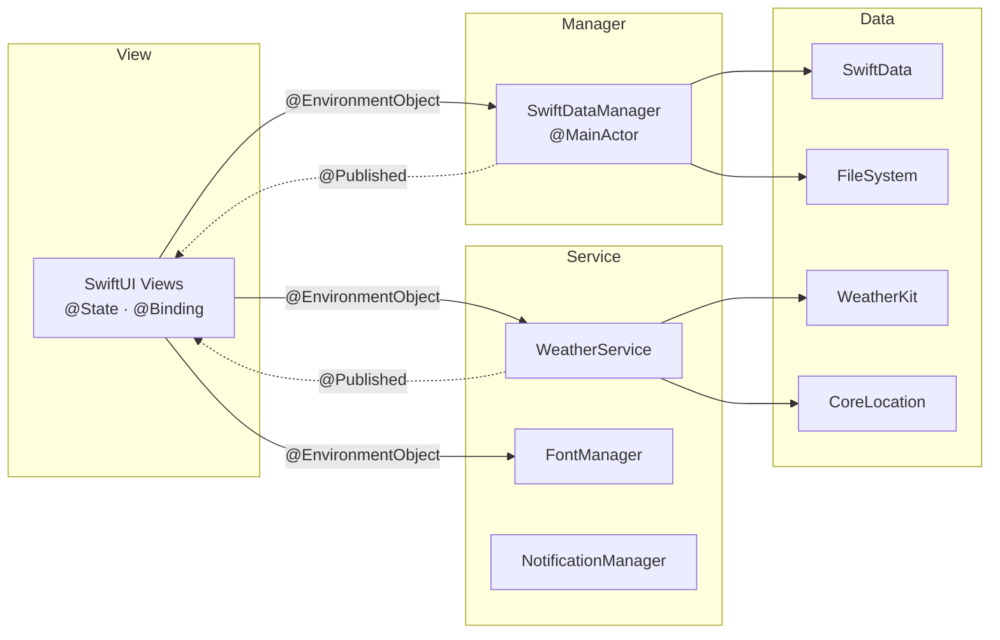
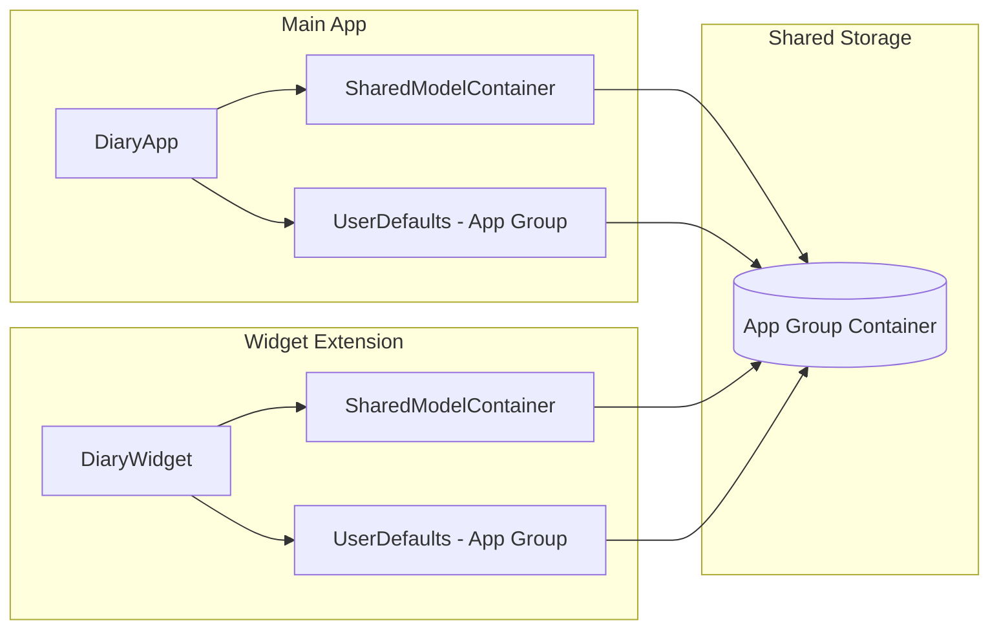
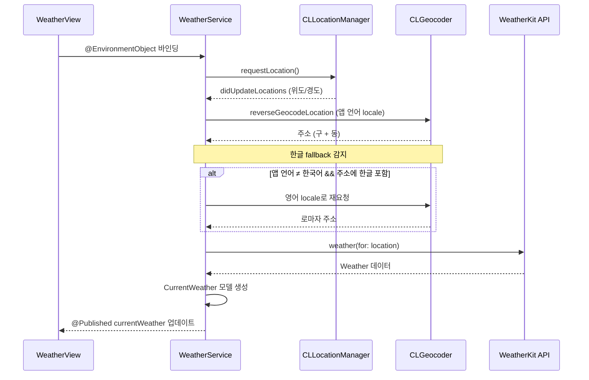
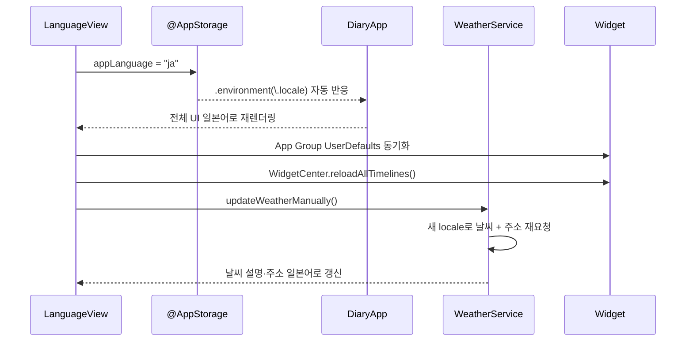

<p align="center">
  
</p>

<h1 align="center">GoodDi (굿디)</h1>

<p align="center">
  오늘의 날씨와 함께 하루를 기록하세요 — 날씨 기반 일기장, 위젯, 다국어를 지원하는 개인 다이어리 앱입니다.
</p>

<p align="center">
  
  
  
  
  
  
  
</p>

---

## Screenshots


| 메인 화면 | 일기 작성 | 일기 상세 |
|:---:|:---:|:---:|
|  |  | |

| 일기 목록 | 설정 | 다크모드 메인화면 |
|:---:|:---:|:---:|
|  |  |  |

| 위젯 (Small) | 위젯 (Medium) | 위젯 (Large) |
|:---:|:---:|:---:|
| |  |  |

---

## Tech Stack

### UI
- **SwiftUI** — 선언형 UI로 전체 화면을 구성했습니다. FSCalendar는 UIViewRepresentable + Coordinator 패턴으로 SwiftUI에 통합했습니다.

### Architecture
- **SwiftUI 기본 구조 (View + ObservableObject)** — View가 `@State`/`@Binding`으로 로컬 상태를 관리하고, `@EnvironmentObject`로 공유 상태(Manager/Service)에 접근합니다. SwiftDataManager가 데이터 CRUD를, WeatherService·FontManager·NotificationManager 등 Service 계층이 비즈니스 로직을 각각 분리하여 담당합니다.

### Persistence
- **SwiftData** — `@Model` 매크로 기반으로 일기 데이터를 관리합니다. App Group 공유 ModelContainer를 통해 메인 앱과 위젯이 동일한 데이터베이스를 읽고 씁니다.

### Weather
- **WeatherKit** — Apple의 네이티브 날씨 API를 async/await로 호출합니다. Combine 타이머를 통해 10분마다 자동 갱신하며, CLLocationManager로 현재 위치의 날씨와 주소를 표시합니다.

### Widget
- **WidgetKit** — Small/Medium/Large 3가지 사이즈를 지원합니다. Large 위젯에는 캘린더 그리드를 표시하며, 딥링크(`diary://compose`)로 탭 시 일기 작성 화면으로 직접 이동합니다.

### Localization
- **String Catalog** — 한국어, 영어, 일본어 3개 언어를 지원합니다. 앱 재시작 없이 설정에서 즉시 언어를 전환할 수 있으며, 위젯에도 App Group UserDefaults를 통해 언어 설정이 동기화됩니다.

### Notification
- **UserNotifications** — 매일 오후 11시를 기준으로 사용자가 일기를 작성하지 않았으면 리마인더 알림을 보냅니다.

### Image
- **PhotosUI (PhotosPicker)** — 사진 라이브러리에서 복수 이미지를 선택하고, 파일 시스템에 저장하여 SwiftData에는 파일명만 기록합니다.

---

## Architecture

### 1. View + ObservableObject + Service 계층 분리



SwiftUI의 기본 데이터 흐름을 따릅니다. View는 `@State`로 로컬 상태를 관리하고, 앱 전체에서 공유가 필요한 상태는 `ObservableObject`를 채택한 Manager/Service 클래스에서 `@Published`로 제공합니다. View는 `@EnvironmentObject`를 통해 이들에 접근하며, 데이터 변경 시 SwiftUI가 자동으로 UI를 갱신합니다. 비즈니스 로직(날씨 조회, 폰트 관리, 알림 스케줄링 등)은 각 Service 클래스에 분리하여 View의 책임을 최소화했습니다.

---

### 2. 위젯 데이터 공유 (App Group + SwiftData)



메인 앱과 위젯은 App Group(`group.com.reimos7.goodd.diary`)을 통해 SwiftData 데이터베이스와 UserDefaults(언어 설정)를 공유합니다. 위젯은 별도 프로세스로 실행되므로, 메인 앱에서 일기를 추가/수정/삭제할 때마다 `WidgetCenter.shared.reloadAllTimelines()`로 위젯 갱신을 요청합니다.

---

### 3. 날씨 데이터 흐름 (WeatherKit + CoreLocation)



위치 권한 획득 후 CLLocationManager에서 좌표를 받아, CLGeocoder로 주소를 변환하고 WeatherKit으로 날씨를 조회합니다. CLGeocoder가 특정 언어로 주소를 번역하지 못할 경우(예: 한국 주소를 일본어로 요청), 한글 감지 후 영어 locale로 재요청하여 로마자 주소를 표시합니다.

---

### 4. 앱 내 언어 전환 흐름



사용자가 언어를 변경하면 `@AppStorage`가 즉시 반영되어 DiaryApp의 `.environment(\.locale)`이 자동으로 새 언어를 적용합니다. 앱 재시작 없이 전체 UI가 즉시 새 언어로 다시 렌더링되며, 위젯에도 App Group을 통해 언어 설정이 동기화됩니다.

---

## Key Features

### 1. 날씨와 함께 일기 작성

현재 위치의 실시간 날씨(아이콘, 기온, 최고·최저 온도, 일출·일몰)를 표시하며, 일기 저장 시 그 날의 날씨 아이콘이 함께 기록됩니다. 날씨 설명은 한국어·영어·일본어로 다국어 번역됩니다.


### 2. 사진 첨부 일기

PhotosPicker를 통해 이미지를 선택하고 일기에 첨부할 수 있습니다. 이미지는 파일 시스템에 저장되며 SwiftData에는 파일명만 기록하여 데이터베이스 부담을 최소화합니다. 전체 화면 줌 뷰와 롱프레스 삭제를 지원합니다.

### 3. 캘린더 기반 일기 관리

FSCalendar를 UIViewRepresentable로 통합하여 월별 일기를 시각적으로 확인할 수 있습니다. 일기가 있는 날짜에 마커가 표시되며, 날짜를 탭하면 해당 날짜의 일기를 작성하거나 조회할 수 있습니다.

### 4. 홈 화면 위젯 (Small / Medium / Large)

WidgetKit으로 3가지 사이즈의 위젯을 제공합니다. Small은 오늘의 일기 미리보기, Medium은 날씨 아이콘과 일기 내용, Large는 캘린더 그리드로 이번 달 일기 현황을 보여줍니다. 위젯 탭 시 딥링크로 일기 작성 화면에 직접 진입합니다.

### 5. 다국어 지원 (한국어 / 영어 / 일본어)

앱 내 설정에서 언어를 변경하면 재시작 없이 즉시 전체 UI가 전환됩니다. String Catalog 기반으로 200개 이상의 문자열이 번역되어 있으며, 날짜 포맷·날씨 설명·위젯까지 모두 선택한 언어로 표시됩니다.

### 6. 커스터마이징 (테마 / 폰트)

라이트,다크,시스템 3가지 테마 모드와 4종의 커스톰 폰트를 제공합니다.

---

## Troubleshooting

### 1. 위젯과 메인 앱 간 데이터 동기화 — App Group 공유 ModelContainer

**문제**
위젯은 메인 앱과 별도 프로세스로 실행되기 때문에, 메인 앱의 SwiftData 데이터베이스에 직접 접근할 수 없었습니다. 일기를 작성해도 위젯에 반영되지 않는 문제가 발생했습니다.

**해결**
App Group(`group.com.reimos7.goodd.diary`)을 통해 공유 ModelContainer를 생성하고, 메인 앱과 위젯 모두 동일한 저장 경로를 사용하도록 설계했습니다. 일기 CRUD 시마다 `WidgetCenter.shared.reloadAllTimelines()`를 호출하여 위젯을 즉시 갱신합니다.

```swift
enum SharedModelContainer {
    static let appGroupIdentifier = "group.com.reimos7.goodd.diary"

    static func create() -> ModelContainer {
        let schema = Schema([Diary.self])
        let config = ModelConfiguration(
            schema: schema,
            groupContainer: .identifier(appGroupIdentifier)
        )
        return try! ModelContainer(for: schema, configurations: [config])
    }
}
```

---

### 2. CLGeocoder 일본어 locale에서 한국 주소가 번역되지 않는 문제 — 한글 감지 + 영어 fallback

**문제**
앱 언어를 일본어로 설정한 상태에서 한국에 위치한 경우, CLGeocoder에 일본어 locale을 전달해도 한국 주소가 한글("강남구 삼성동")로 그대로 반환되었습니다. Apple의 지도 데이터베이스에 한국 주소의 일본어 번역이 존재하지 않기 때문입니다.

**해결**
CLGeocoder 응답에서 한글 포함 여부를 정규표현식으로 감지하고, 앱 언어가 한국어가 아닌데 한글이 포함된 경우 영어 locale로 재요청하여 로마자 주소("Gangnam-gu Samseong-dong")를 표시하는 fallback 전략을 적용했습니다.

```swift
if currentLangCode != "ko" && address.containsKorean {
    let enGeocoder = CLGeocoder()
    let enPlacemarks = try await enGeocoder.reverseGeocodeLocation(
        location, preferredLocale: Locale(identifier: "en")
    )
    if let enPlacemark = enPlacemarks.first,
       let enGu = enPlacemark.locality,
       let enDong = enPlacemark.subLocality {
        return "\(enGu) \(enDong)"
    }
}
```

---

### 3. 앱 재시작 없는 언어 전환 — @AppStorage + .environment(\.locale)

**문제**
일반적으로 iOS 앱의 언어 변경은 앱 재시작이 필요합니다. 하지만 일기 앱 특성상 작성 중 데이터 유실 없이 즉시 전환되어야 했습니다.

**해결**
`@AppStorage("appLanguage")`로 선택된 언어를 저장하고, DiaryApp의 `WindowGroup`에 `.environment(\.locale, Locale(identifier: appLanguage))`를 적용했습니다. `@AppStorage` 값이 변경되면 SwiftUI가 자동으로 전체 뷰 트리를 새 locale로 다시 렌더링합니다. Foundation API(DateFormatter, CLGeocoder 등)에는 `appLocale` computed property를 통해 명시적으로 locale을 전달하여 SwiftUI 외부에서도 언어가 올바르게 반영되도록 했습니다.

```swift
// DiaryApp.swift
.environment(\.locale, Locale(identifier: appLanguage))

// Foundation API용 (DateFormatter, CLGeocoder 등)
var appLocale: Locale {
    let code = UserDefaults.standard.string(forKey: "appLanguage") ?? "en"
    return Locale(identifier: code)
}
```

---

### 4. WeatherKit API 호출 최적화 — Combine 타이머 + 포그라운드 전용

**문제**
WeatherKit은 Apple Developer Program 멤버십 기준 월 500,000회 호출이 가능하지만, 사용자 수가 늘어나면 호출량이 급증할 수 있습니다. 또한 불필요한 API 호출은 배터리 소모와 네트워크 트래픽 낭비로 이어집니다.

**해결**
Combine의 `Timer.publish(every: 600)`으로 10분 간격 자동 갱신 타이머를 설정하되, `.main` RunLoop에서 실행하여 백그라운드에서는 자동으로 정지되도록 했습니다. 이로써 앱이 포그라운드 상태일 때만 API를 호출하여, 불필요한 호출을 방지하면서도 날씨 정보의 신선도를 유지합니다.

```swift
timer = Timer.publish(every: 600, on: .main, in: .common)
    .autoconnect()
    .sink { [weak self] _ in
        self?.updateWeatherManually()
    }
```

---

### 5. 이미지 저장 시 데이터베이스 비대화 방지 — 파일명 전략

**문제**
일기에 첨부된 사진을 SwiftData에 `Data` 타입으로 직접 저장하면 데이터베이스 크기가 급격히 증가하고, 메모리 사용량이 과도해지는 문제가 있었습니다.

**해결**
이미지는 앱의 Documents 디렉토리에 파일로 저장하고, SwiftData에는 파일명(`String`)만 기록하는 전략을 채택했습니다. 절대 경로 대신 파일명만 저장하여 앱 재설치 시에도 경로 불일치 문제를 방지합니다. 일기 삭제 시에는 연결된 이미지 파일도 함께 삭제하여 저장 공간 누수를 방지합니다.

```swift
@Model
class Diary {
    var content: String
    var date: Date
    var imagePath: [String]?  // 파일명만 저장 (절대경로 X)
    var currentWeatherImage: String?
}

// 일기 삭제 시 이미지 파일도 함께 제거
func deleteDiaryData(entry: Diary) {
    if let paths = entry.imagePath {
        for path in paths {
            FileManagerSet.deleteImageFromFileManager(fileName: path)
        }
    }
    context.delete(entry)
}
```

---

## Project Structure

```
Diary/
├─ Application/
│  └─ DiaryApp.swift              # 앱 진입점 (테마/언어/딥링크 설정)
├─ Model/
│  ├─ Model.swift                 # @Model Diary (SwiftData)
│  ├─ CurrentWeather.swift        # 날씨 도메인 모델
│  ├─ CodableCurrentWeather.swift # Codable 날씨 DTO
│  ├─ SwiftDataManager.swift      # CRUD 매니저 (@MainActor)
│  └─ SharedModelContainer.swift  # App Group 공유 컨테이너
├─ View/
│  ├─ MainView.swift              # 홈 (날씨 + 캘린더 + 작성 버튼)
│  ├─ ComposeView.swift           # 일기 작성 (사진 + 날씨)
│  ├─ CalendarComposeView.swift   # 특정 날짜 일기 작성
│  ├─ EditComposeView.swift       # 일기 수정
│  ├─ DetailView.swift            # 일기 상세 조회
│  ├─ ListView.swift              # 일기 목록 (정렬/검색)
│  ├─ SearchView.swift            # 키워드 검색
│  ├─ CalendarSetView.swift       # FSCalendar 통합
│  ├─ WeatherView.swift           # 날씨 카드
│  ├─ SettingView.swift           # 설정 메뉴
│  ├─ ThemeView.swift             # 테마 선택
│  ├─ FontView.swift              # 폰트 선택
│  ├─ NotificationView.swift      # 알림 설정
│  ├─ LanguageView.swift          # 언어 선택
│  ├─ PhotoPickerView.swift       # 사진 선택
│  ├─ FullScreenImageView.swift   # 이미지 줌 뷰
│  └─ LaunchScreenView.swift      # 스플래시 화면
├─ Service/
│  ├─ WeatherService.swift        # 날씨 + Combine 타이머
│  ├─ WeatherService+Location.swift  # CLLocationManager 델리게이트
│  ├─ WeatherService+Api.swift    # WeatherKit API 호출
│  ├─ NotificationManager.swift   # 리마인더 알림
│  ├─ FontManager.swift           # 커스텀 폰트 관리
│  ├─ PhotoPermissionManager.swift # 사진 권한
│  ├─ EmailManager.swift          # 인앱 이메일
│  └─ CaptureManager.swift        # 스크린샷 유틸
├─ Extension/
│  ├─ DateFormatter+dateFormatter.swift  # 다국어 날짜 포맷
│  ├─ String+WeatherSymbol.swift  # 날씨 → SF Symbol 매핑
│  ├─ Double+TemperatureString.swift  # 온도 포맷
│  └─ View+Function.swift         # 커스텀 키보드 툴바
├─ Font/                          # 커스텀 폰트 파일 (4종)
├─ Localization/
│  ├─ ko.lproj/                   # 한국어
│  ├─ en.lproj/                   # 영어
│  └─ ja.lproj/                   # 일본어
│
├─ DiaryWidget/                   # 위젯 익스텐션
│  ├─ DiaryWidget.swift           # Small/Medium/Large 위젯
│  └─ DiaryWidgetBundle.swift     # 위젯 진입점
│
└─ Localizable.xcstrings          # String Catalog (200+ 키)
```

---

## License

이 프로젝트는 개인 포트폴리오 프로젝트이며, 상업적 사용을 금지합니다.
